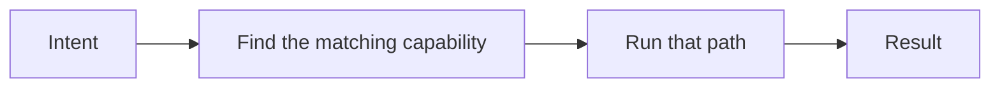

# Elastic Web

You state an intent. Elastic Web returns the capability that can do it, not the whole catalog.

Vedaxi is the name. This repository is the open protocol.

[Live view](https://vedaxi.com/elasticweb) · demonstration, it does not book, pay, or contact anyone.

This is not the [research-integrity desk](https://github.com/luxurylifestyleco/vedaxi-integrity-desk).

## Start

[Five minutes](docs/QUICKSTART.md) · [How the pieces fit](ARCHITECTURE.md)

Apache-2.0. The Vedaxi name is not part of that license.
